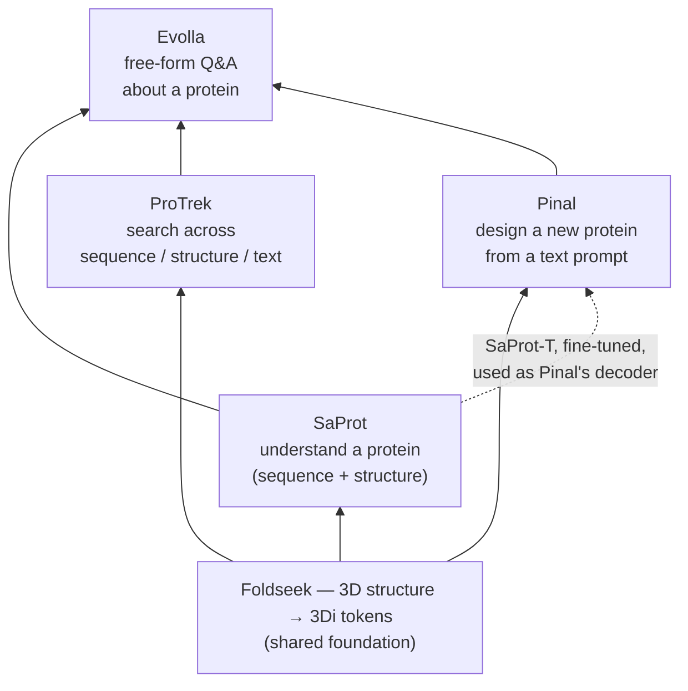

# Running SaProt, ProTrek & Pinal — and why Evolla had to wait

**Md Maidul Islam** · China University of Petroleum, Beijing
Prepared for **Prof. Fajie Yuan**, Westlake University — following up on his suggestion to study and run the group's open-source projects.


---

## TL;DR

| Repo | What it does | Ran locally? | Result I verified |
|---|---|:---:|---|
| **SaProt** | Score whether a mutation helps or hurts a protein | ✅ | Correctly flagged p53's cancer mutation **R175H** as damaging (score **−1.39**), zero fine-tuning |
| **ProTrek** | Search across sequence ↔ structure ↔ function-text | ✅ | Matched human insulin → *"regulates blood glucose"*; matched p53's 3D shape alone → *"tumor suppressor"* |
| **Pinal** | Generate a new protein from a text description | ✅ | `"Actin."` → generated sequence whose N-terminus closely matches real human beta-actin |
| **Evolla** | Chat-style Q&A about a protein | ⚠️ not run | Smallest checkpoint is 10B params — beyond this laptop; hosted demo currently down server-side |

Everything below is the detail behind that table: what each model actually does, what broke while running it, and how I fixed it.

## A note on tools

I don't have a biology background, so for this exercise I used **Claude Code** as a pair-programming
tool — mainly for environment setup and dependency debugging, the way I'd use an AI-assisted IDE. Every
result below is something I ran myself and cross-checked against known biology (e.g. confirming the p53
mutation is a real, well-documented cancer mutation before trusting the model's score). Flagging this
upfront rather than leaving it implicit.

**Setup:** MacBook Pro, M1, 17GB RAM, no dedicated GPU. Google Colab's free T4 was tried first for SaProt
but disconnected too often to rely on, so everything below runs locally.

---

## How the four fit together

They aren't four unrelated projects — three of them share one core trick: turning a protein's 3D shape
into a short sequence of letters (via Foldseek's "3Di" alphabet) so a structure can be fed into a language
model exactly like an amino-acid sequence can.



Reading it bottom-up: **understand → search → design → talk**, each stage reusing the representation the
previous one established. Pinal is, loosely, ProTrek run in reverse — instead of matching an existing
sequence/structure to text, it starts from text and generates a new sequence/structure to match it.

---

## 1. SaProt — does this mutation help or hurt?

**Repo:** [westlake-repl/SaProt](https://github.com/westlake-repl/SaProt)

A protein language model that encodes amino acid identity *and* local 3D shape (as a "3Di" token) in one
combined vocabulary, so it can reason about sequence and structure jointly.

**What I ran**
- Baseline masked-token inference with `SaProt_35M_AF2`.
- A structure→mutation-effect pipeline built from scratch: downloaded the Foldseek binary, extracted 3Di
  tokens from a real structure with `get_struc_seq()`, then implemented the paper's zero-shot **"masked
  marginal"** scoring method myself (mask the mutated position, compare the model's predicted
  log-probability for the wild-type vs. mutant token).

**Validation, not just "it ran"**
> Tested the well-known cancer-associated **p53 mutation R175H** (AlphaFold structure for human TP53).
> SaProt scored it **−1.39 (unfavorable)** — correctly identifying real, clinically documented damage,
> with no fine-tuning at all.

**Got stuck on:** ColabSaprot's free T4 GPU kept disconnecting mid-session — switched to running the
underlying HuggingFace model directly instead of depending on the notebook UI.

**Question for Prof. Yuan:** How sensitive is prediction quality to the accuracy of the input structure —
if the only available structure is a low-confidence AlphaFold prediction rather than an experimental one,
how much does that degrade downstream tasks like mutation scoring?

---

## 2. ProTrek — sequence, structure, and text, all searchable against each other

**Repo:** [westlake-repl/ProTrek](https://github.com/westlake-repl/ProTrek)

A trimodal model that aligns protein sequence, structure, and natural-language function descriptions in
one embedding space via contrastive learning.

**What I ran**
- **Sequence → text:** gave it human insulin's sequence plus five candidate function descriptions — it
  ranked *"a hormone that regulates blood glucose levels"* highest, by a wide margin.
- **Structure → text:** repeated the test using *only* p53's 3D structure, no sequence at all — it still
  correctly matched *"a tumor suppressor protein that prevents cancer by regulating the cell cycle."*

**Got stuck on:** the repo pins `torchmetrics`/`transformers` versions whose APIs have since changed
(`Accuracy()` now requires a `task` arg, `_LRScheduler` dropped `verbose`, `batch_encode_plus` was
removed). Fixed with three small, targeted monkey-patches rather than downgrading the whole environment.

**Question for Prof. Yuan:** For protein families with very sparse function annotation, can the
sequence/structure modalities compensate during contrastive training, or does retrieval quality degrade
notably for poorly-annotated families?

---

## 3. Pinal — describe a protein, get a sequence

**Repo:** [westlake-repl/Denovo-Pinal](https://github.com/westlake-repl/Denovo-Pinal)

Text-guided de novo protein design: a text description → a 3D structure (via T2struc) → an amino acid
sequence (via SaProt-T, a fine-tuned SaProt).

**What I ran:** the smallest available checkpoint pair, **T2struc-1.2B + SaProt-T** (~7.5GB), fully
locally. Given the description `"Actin."`:

```
MCDEETAALVVDNGSGMCKAGFAGDDAPRAVFPSIVGRPRHQGVMVGMGQKDSYVGDEAQSKRGILTLKYPIEHGIVTNWDDMEKIWHHTFYNELRV...
```

The N-terminal region closely matches real human beta-actin — the model drew on genuine structural
knowledge rather than producing arbitrary output.

<details>
<summary><b>This was the most involved debugging of the four (click to expand)</b></summary>

1. The repo's custom GPT-2 code depends on `transformers`'s `SequenceSummary` class, which has since been
   removed entirely — not fixable with a small patch, so I built a **separate Python 3.10 environment**
   pinned to the repo's exact dependency versions (`torch==2.2.1`, `transformers==4.39.0`), so the
   working SaProt/ProTrek setup stayed untouched.
2. PyTorch's MPS backend (Apple GPU) doesn't support `bfloat16`, which these checkpoints are stored in —
   fell back to CPU (~9 min per generated protein).
3. The SaProt-T checkpoint's pickle format required `deepspeed` to simply be importable (unused at
   inference time) — the latest `deepspeed` conflicts with the pinned PyTorch version, so I installed the
   exact version (`0.14.0`) the repo itself targets.

</details>

**Question for Prof. Yuan:** Given that the "Actin" output closely resembled the real protein, how is
novelty vs. memorization evaluated for genuinely novel design targets (e.g. a hypothetical enzyme with no
close natural analog)?

---

## 4. Evolla — read, not yet run

**Repo:** [westlake-repl/Evolla](https://github.com/westlake-repl/Evolla)

Combines a protein encoder with a large language model decoder for free-form protein Q&A.

The smallest available checkpoint is **10B parameters** (up to 80B for the larger variant) — beyond what
a 17GB-RAM laptop with no dedicated GPU can load. I tried the hosted demo, **chat-protein.com**, as an
alternative; it's currently returning a DNS/Cloudflare error server-side (checked multiple times over
several days). I've read the paper and repo in full and understand the architecture; I'll keep retrying
the hosted demo.

**Question for Prof. Yuan:** Is there (or are there plans for) a smaller/distilled/quantized Evolla usable
on limited hardware, or is a large LLM decoder essentially required for this kind of task?

---

## Overall reflection

Taken together, these read less like four separate projects and more like one connected pipeline: the
3Di structure-tokenization idea from SaProt is reused directly inside ProTrek and inside Pinal's SaProt-T
component, and there's a clear progression from *understanding* proteins, to *searching* them, to
*generating* them, to eventually *discussing* them in natural language.

The biggest practical lesson: published research code is rarely "pip install and run" a year or two
later. Most of the real effort went into diagnosing environment/dependency mismatches rather than the
modeling logic itself — a skill that seems just as relevant here as the modeling side.
